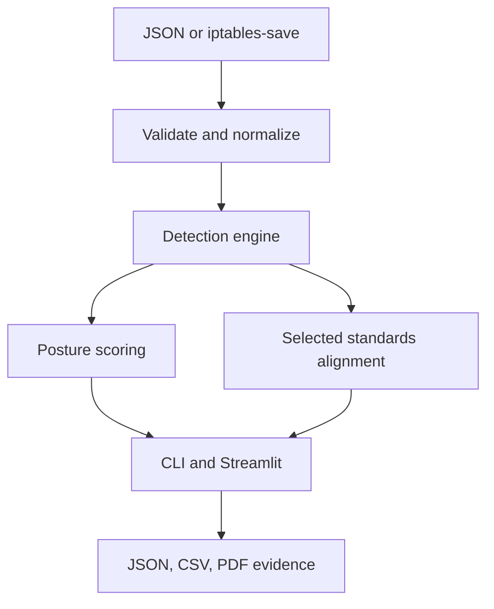

# FirewallGuard

**Explainable firewall configuration auditing for custom JSON and real `iptables-save` rulesets.**

FirewallGuard is a defensive Python project that normalizes firewall rules, detects risky and
unreachable policy patterns, produces evidence-backed remediation, and exports review-ready JSON,
CSV, and PDF results. It is designed to demonstrate security-engineering judgment: accurate scope,
testable logic, reproducible evidence, and explicit limitations.

> FirewallGuard performs selected deterministic configuration checks. It is not a penetration test,
> proof of compromise, compliance certification, or substitute for environment-specific review.

## Why this project is different

- Parses both a documented JSON schema and authentic `iptables-save` syntax.
- Prevents common false positives: disabled rules, deny rules, loopback traffic, and
  `ESTABLISHED,RELATED` return traffic are not treated as active exposures.
- Detects unrestricted allows, public administration/database/SMB services, cleartext services,
  all-port rules, duplicates, and conservative rule shadowing.
- Attaches the affected rule, concrete evidence, remediation, likelihood, impact, and confidence to
  every finding.
- Maps only implemented checks to selected NIST CSF 2.0 and CIS Controls v8.1 outcomes. It never
  converts a few technical checks into a misleading organization-wide compliance percentage.
- Labels MITRE ATT&CK techniques as *related context*, never as observed adversary activity.
- Generates reports in memory, avoiding cross-session file collisions in a hosted dashboard.
- Includes 44 automated tests and 91% measured line coverage across the audit, alignment, and report
  engines, including false-positive resistance and PDF generation.

## Architecture



See [architecture](docs/architecture.md), [threat model](docs/threat_model.md), and
[standards mapping](docs/compliance_mapping.md) for the technical decisions behind the pipeline.

## Detection catalog

| Finding | What it identifies | Key false-positive controls |
|---|---|---|
| `UNRESTRICTED_ALLOW` | Active any-source, any-destination, any-port access or permissive inbound/forward policy | Ignores deny, disabled, loopback, return traffic, and default OUTPUT allow |
| `PUBLIC_ADMIN_SERVICE` | SSH, Telnet, RDP, VNC, or WinRM open to every source | Requires active allow and non-outbound scope |
| `PUBLIC_DATABASE_SERVICE` | Common database services open to every source | Requires active allow and non-outbound scope |
| `PUBLIC_SMB_SERVICE` | SMB/NetBIOS open to every source | Requires active allow and non-outbound scope |
| `CLEARTEXT_SERVICE` | FTP or Telnet permitted | Severity depends on public vs restricted source |
| `ALL_PORTS_ALLOWED` | An active service rule permits the complete port range | Excludes policies and already-reported any-to-any rules |
| `DUPLICATE_RULE` | Same ordered match and action appears more than once | Includes interface and connection-state context |
| `SHADOWED_RULE` | Earlier terminal rule conservatively covers a later rule | Considers chain, protocol, CIDR containment, ports, interfaces, and states |
| `DISABLED_RULE_HYGIENE` | Inactive rule requiring lifecycle review | Informational only; zero posture penalty |

## Quick start

### 1. Create an environment

Windows PowerShell:

```powershell
py -3.11 -m venv .venv
.\.venv\Scripts\Activate.ps1
python -m pip install --upgrade pip
python -m pip install -r requirements.txt
```

Linux or macOS:

```bash
python3 -m venv .venv
source .venv/bin/activate
python -m pip install --upgrade pip
python -m pip install -r requirements.txt
```

### 2. Run the CLI

```bash
python main.py sample_configs/vulnerable_firewall.json
python main.py sample_configs/iptables_vulnerable.rules --format iptables
```

Export the complete evidence package:

```bash
python main.py sample_configs/vulnerable_firewall.json \
  --json-output output/firewall_audit_report.json \
  --pdf output/pdf/firewall_audit_report.pdf
```

Use an exit code for CI policy gates:

```bash
python main.py sample_configs/corporate_firewall.json --fail-on high
```

Exit codes are `0` for successful analysis, `1` for invalid input/runtime error, and `2` when the
optional severity threshold is reached.

### 3. Run the dashboard

```bash
streamlit run dashboard/app.py
```

The guided samples let reviewers compare vulnerable and hardened JSON/iptables configurations
without uploading sensitive data.

### 4. Run the automated tests

No test framework is required for the baseline suite:

```bash
python -m unittest discover -s tests -v
```

## Supported input

### JSON

The schema is available at [`schema/firewall-config.schema.json`](schema/firewall-config.schema.json).
Addresses accept individual IPv4/IPv6 values, CIDRs, or `any`. Ports accept a number, comma-separated
list, range (`8000-8010` or `8000:8010`), or `any`.

```json
{
  "rules": [
    {
      "rule_id": "ADMIN-SSH-001",
      "name": "Restricted SSH",
      "action": "allow",
      "protocol": "tcp",
      "source": "10.10.50.0/24",
      "destination": "192.168.1.10",
      "port": "22",
      "enabled": true,
      "chain": "INPUT",
      "description": "Administration subnet only"
    }
  ]
}
```

### iptables-save

FirewallGuard parses built-in chain policies, appended rules, protocol, source/destination,
destination ports and multiports, input/output interfaces, connection states, targets, and comments.
Negated matches fail closed with an explicit validation error rather than being misinterpreted.

## Posture score

The 0-100 posture score is a transparent project-specific prioritization aid. It is not CVSS and is
not a compliance score. Each active rule receives the full weight of its highest-risk finding;
additional independent findings on that rule add a small capped penalty. This reduces double-counting
while preserving materially different evidence. Thresholds and weights are implemented in
[`audit_engine/scoring.py`](audit_engine/scoring.py).

## Reproducibility and evidence

Every result includes:

- deterministic audit ID derived from the input;
- complete SHA-256 input fingerprint;
- UTC generation timestamp;
- source name and detected format;
- normalized rule set and parser warnings;
- finding IDs, evidence, remediation, and methodology;
- exact selected standards references and a non-certification disclaimer.

## Project structure

```text
FirewallGuard/
├── audit_engine/       # Models, validation, parsers, detectors, scoring, service
├── compliance/         # Selected standards-alignment checks
├── dashboard/          # Streamlit interface and Plotly visualizations
├── docs/               # Architecture, threat model, and mapping rationale
├── reports/            # In-memory professional PDF generation
├── sample_configs/     # Vulnerable and hardened JSON/iptables cases
├── schema/             # JSON Schema for the custom input model
├── tests/              # 44 tests; 91% measured core/report line coverage
├── main.py             # CLI entry point
└── pyproject.toml      # Package metadata and tool configuration
```

## Security boundaries and limitations

- Use only on configurations you are authorized to assess.
- Sanitized examples use private RFC 1918 addresses. Review production rules before uploading them.
- Static policy analysis cannot account for routing, NAT, host state, identity controls, asset
  criticality, compensating controls, or actual exploitability without additional context.
- ATT&CK mappings describe possible relationships; FirewallGuard does not detect adversary behavior.
- A `NO_GAP_DETECTED` control result means only that the implemented pattern did not trigger.
- Custom chains, negated matches, ipsets, rate limits, NAT semantics, and vendor-specific policy
  behavior require further analysis. Unsupported negated matches are rejected rather than guessed.

Read the complete [threat model](docs/threat_model.md) and [security policy](SECURITY.md) before
hosting the application.

## Portfolio-ready description

> Built FirewallGuard, an explainable Python firewall-policy auditor supporting validated JSON and
> real `iptables-save` inputs. Implemented false-positive-aware exposure, duplicate, and rule-shadowing
> analysis; evidence-backed NIST CSF 2.0/CIS v8.1 alignment; in-memory PDF/JSON/CSV reporting; and 44
> automated regression tests.

## Roadmap

- nftables parser and semantic model
- AWS Security Group and Azure NSG adapters
- NAT-aware reachability analysis
- baseline-to-candidate policy diff and pull-request annotations
- SARIF output for security pipelines
- property-based parser testing and benchmark corpus

## License

Released under the [MIT License](LICENSE).
