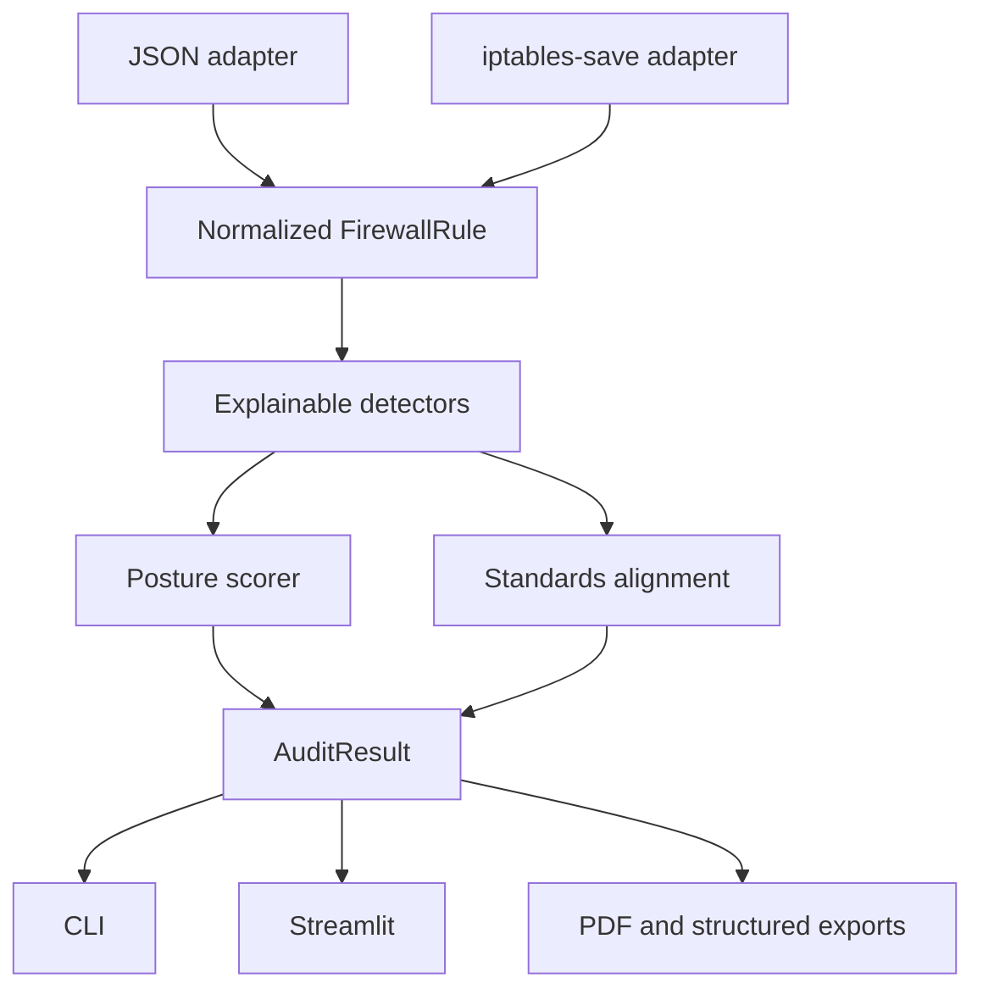

# Architecture

## Design goals

FirewallGuard separates input-specific parsing from security analysis. Every adapter must normalize
to the same immutable `FirewallRule` model so detectors can be tested independently of file syntax.
The dashboard and CLI call one orchestration service, preventing inconsistent results between user
interfaces.

## Components

| Component | Responsibility |
|---|---|
| `audit_engine/parser.py` | Strict format detection, validation, normalization, and parser warnings |
| `audit_engine/models.py` | Immutable domain objects and serializable audit result |
| `audit_engine/detectors.py` | Independent evidence-producing checks and conservative rule-order analysis |
| `audit_engine/scoring.py` | Transparent posture prioritization with per-rule double-count protection |
| `audit_engine/service.py` | Single pipeline used by every interface |
| `compliance/compliance_engine.py` | Selected framework outcome checks with explicit scope/disclaimer |
| `reports/pdf_reporter.py` | Escaped, in-memory PDF with evidence, limitations, and normalized-rule appendix |
| `dashboard/` | Guided samples, analysis views, filters, and in-memory exports |
| `main.py` | Automation-friendly CLI and optional severity gate |

## Trustworthy-failure choices

- Invalid actions, addresses, ports, booleans, duplicate IDs, and empty inputs are rejected.
- Negated iptables matches are rejected until their semantics are implemented.
- Unknown non-rule iptables lines generate warnings; they are not silently treated as rules.
- Loopback and established/related return flows are preserved in the model but excluded from exposure
  findings.
- Reports escape configuration-derived text and are produced per request in memory.

## Extension contract

A future adapter should return `ParsedConfiguration`, including format name and any unhandled semantic
warnings. A new detector should inherit `BaseDetector`, produce immutable `Finding` objects, and add
positive, negative, and interaction tests. It must not introduce a framework or ATT&CK claim without
explicit source/version/context.
