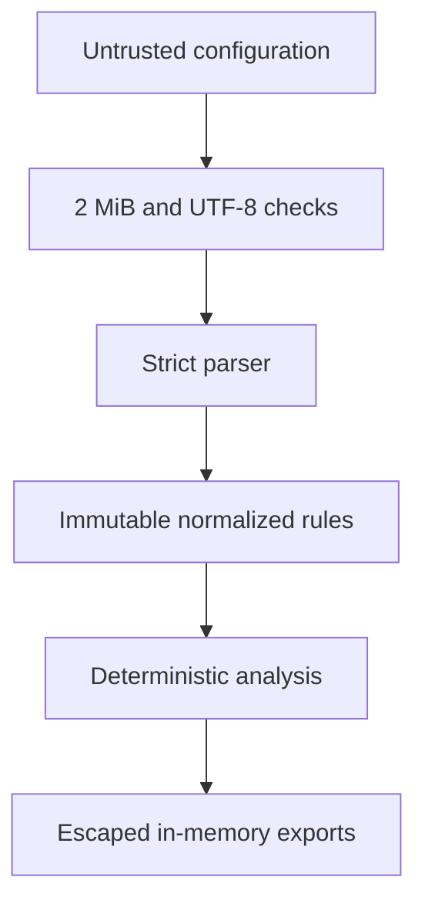

# Threat model

## Scope

This model covers the local CLI, Streamlit dashboard, parsing/analysis pipeline, and generated
evidence. It does not cover the security of the operating system, reverse proxy, identity provider,
CI runner, or hosting platform.

## Assets

- firewall configuration confidentiality;
- correctness and integrity of findings;
- availability of the analysis service;
- separation of reports between user sessions;
- integrity of standards and ATT&CK descriptions.

## Trust boundaries

## Threats and mitigations

| Threat | Mitigation | Residual risk |
|---|---|---|
| Oversized upload exhausts memory | Dashboard rejects inputs larger than 2 MiB | CLI operators must enforce their own file-size policy |
| Malformed JSON or iptables text causes ambiguous analysis | Strict validation, explicit exceptions, fail-closed negation handling | Some valid advanced iptables semantics remain unsupported |
| Uploaded text injects report markup | Configuration-derived PDF content is XML-escaped | Future output formats must preserve escaping |
| Concurrent users overwrite reports | Dashboard generates PDF bytes in memory per session | Hosting/runtime memory isolation still matters |
| Sensitive rules leak through logs | Raw input is not logged by application code | Reverse proxies or platform telemetry may require separate review |
| False positive from loopback or return traffic | Interface and connection-state context suppresses exposure findings | Routing/NAT and custom-chain context can still change reachability |
| Misleading compliance claim | Selected outcomes, versions, scope, and disclaimer are embedded in UI/report | Human readers may still misuse automated output |
| ATT&CK mapping interpreted as compromise | UI/report state that techniques are contextual and not observed | Requires analyst education and review |
| Dependency compromise | Minimal direct dependencies, version ranges, CI install/check | Add lockfile/SBOM/signing for production distribution |

## Deployment recommendations

Run as the included non-root container user, add authentication and TLS at the edge, restrict network
egress, avoid logging uploaded contents, keep the in-memory report workflow, and define retention and
deletion policies before assessing real infrastructure.
